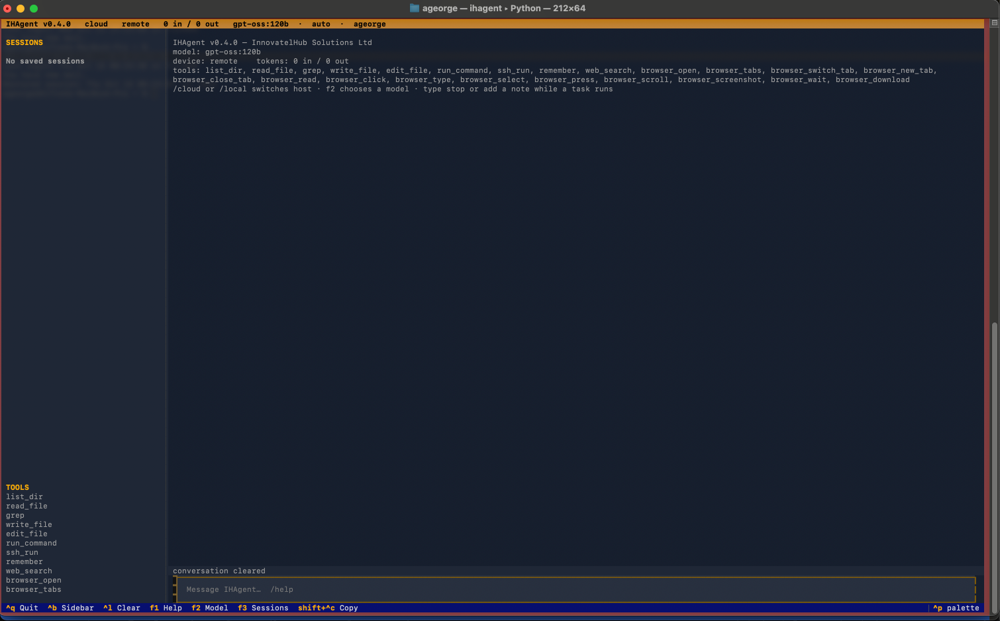
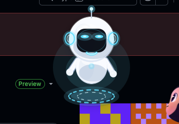

# IHAgent

IHAgent is a terminal coding agent from InnovatelHub Solutions Ltd. The command is `ihagent` (the same program is also installed as `hfagent`). It runs a tool-calling loop — thought, action, observation — against any OpenAI-compatible chat API. It can read, search, and edit files, run shell and SSH commands, search and drive a dedicated Chrome window, and call tools from Model Context Protocol servers.

On a real terminal the default interface is a Textual TUI. `--console` is the line REPL, and `-p` runs one prompt and exits. On macOS, a floating iheye bubble stays above other apps while the terminal that hosts ihagent is in the background.

Package `hfagent` 0.4.0, Python 3.10+, license MIT (declared in `ihagent/pyproject.toml`). Sources live in [`ihagent/src/hfagent`](ihagent/src/hfagent).



The screenshot is a live session on Ollama Cloud (`host` label `cloud`, device `remote`, model `gpt-oss:120b`, approval `auto`). The default model, when nothing else is set, is `Qwen/Qwen2.5-Coder-32B-Instruct` on the Hugging Face router.

## Contents

- [Installation](#installation)
  - [macOS](#macos)
  - [Linux](#linux)
  - [Windows](#windows)
  - [Install troubleshooting](#install-troubleshooting)
- [Install and quick start](#install-and-quick-start)
- [TUI](#tui)
- [Command line](#command-line)
- [Configuration](#configuration)
- [Backends](#backends)
- [Context, reasoning, and errors](#context-reasoning-and-errors)
- [Tools](#tools)
- [Browser](#browser)
- [MCP servers](#mcp-servers)
- [iheye](#iheye)
- [Approvals and safety](#approvals-and-safety)
- [Terminal restore](#terminal-restore)
- [Skills, memory, and sessions](#skills-memory-and-sessions)
- [Self-hosting on Kaggle](#self-hosting-on-kaggle)
- [Slash commands](#slash-commands)
- [Troubleshooting](#troubleshooting)
- [Project layout and tests](#project-layout-and-tests)

## Installation

Python 3.10 or newer. Python 3.12 is the one to use. A newer interpreter (for example 3.15) warns and still runs; current Playwright releases publish 3.15 wheels, and on macOS PyObjC may lag. The installers create a `.venv` in the repository, install the `browser` extra, and on macOS the `iheye` extra. They then run `python -m playwright install chromium` (on Windows, `.venv\Scripts\python.exe -m playwright install chromium`, which does not need administrator rights). They write `~/.hfagent/.env` when that file is absent, and put `ihagent` on `PATH`. An existing `~/.hfagent/.env` is never overwritten.

`iheye` is macOS-only (PyObjC). Linux and Windows install `ihagent[browser]` and leave that extra off.

The user file, when the installer creates it:

```text
HF_API_KEY=
OLLAMA_API_KEY=
HF_BASE_URL=https://router.huggingface.co/v1
HFAGENT_MODEL=Qwen/Qwen2.5-Coder-32B-Instruct
```

Blank keys are ignored. `HF_TOKEN` is also read for the Hugging Face router. Fill in `HF_API_KEY` or `OLLAMA_API_KEY` before a cloud model will answer. `ihagent --version` prints `0.4.0`.

### macOS

```bash
curl -fsSL https://raw.githubusercontent.com/alfnitacoder/ihagent/master/install.sh | bash
```

From a clone you already have: `./install.sh`. The script installs `ihagent[browser,iheye]`, links `ihagent` and `hfagent` into `~/.local/bin`, and tells you to add that directory to `PATH` when it is missing. Remove the venv and those links with `./install.sh --uninstall`. `~/.hfagent` is left as it is.

Manual equivalent:

```bash
git clone https://github.com/alfnitacoder/ihagent.git
cd ihagent
python3.12 -m venv .venv
source .venv/bin/activate
python -m pip install -e "ihagent[browser,iheye]"
python -m playwright install chromium
# Google Chrome is fine too: python -m playwright install chrome
mkdir -p ~/.hfagent
test -f ~/.hfagent/.env || cat > ~/.hfagent/.env <<'EOF'
HF_API_KEY=
OLLAMA_API_KEY=
HF_BASE_URL=https://router.huggingface.co/v1
HFAGENT_MODEL=Qwen/Qwen2.5-Coder-32B-Instruct
EOF
chmod 600 ~/.hfagent/.env
ihagent
```

Use `python3.12` when that command exists. Any Python 3.10–3.13 works (`python3 -m venv .venv`). `iheye` installs `pyobjc-framework-Cocoa`, `pyobjc-framework-Quartz`, and `pyobjc-framework-Vision`.

### Linux

Same installer. The `iheye` extra is skipped.

```bash
curl -fsSL https://raw.githubusercontent.com/alfnitacoder/ihagent/master/install.sh | bash
```

From a clone: `./install.sh`. Uninstall: `./install.sh --uninstall`.

Manual equivalent:

```bash
git clone https://github.com/alfnitacoder/ihagent.git
cd ihagent
python3.12 -m venv .venv
source .venv/bin/activate
python -m pip install -e "ihagent[browser]"
python -m playwright install chromium
mkdir -p ~/.hfagent
test -f ~/.hfagent/.env || cat > ~/.hfagent/.env <<'EOF'
HF_API_KEY=
OLLAMA_API_KEY=
HF_BASE_URL=https://router.huggingface.co/v1
HFAGENT_MODEL=Qwen/Qwen2.5-Coder-32B-Instruct
EOF
chmod 600 ~/.hfagent/.env
ihagent
```

### Windows

```powershell
irm https://raw.githubusercontent.com/alfnitacoder/ihagent/master/install.ps1 | iex
```

From a clone you already have: `powershell -ExecutionPolicy Bypass -File .\install.ps1`.

The installer does not activate the virtualenv and never runs `Activate.ps1`. It always calls `.venv\Scripts\python.exe`, so a "running scripts is disabled" execution policy does not block the venv. `ihagent.cmd` and `hfagent.cmd` are written to `%USERPROFILE%\.local\bin`. That directory is added to your user `PATH` and to the current session. `ihagent` works in the window that ran the installer. Open a new terminal so other windows can find it: a new Windows Terminal tab, or Windows PowerShell or Command Prompt from the Start menu.

`py -3.12` is used when the Python install manager has it. Python 3.15 is accepted (the installer prints a warning and continues). If 3.12 is missing, the installer uses the Python you already have. To install 3.12 non-interactively, re-run with `-InstallPython`, which runs `py install --yes 3.12`. From the one-liner, set `$env:IHAGENT_INSTALL_PYTHON = "1"` first. Without that flag it does not try to install Python.

Playwright installs bundled Chromium (`.venv\Scripts\python.exe -m playwright install chromium`). That does not need administrator rights. `playwright install chrome` is optional; on Windows it can fail with "Failed to install Google Chrome" unless you re-run it as Administrator. IHAgent uses Google Chrome when that channel is installed, and bundled Chromium when `HFAGENT_BROWSER_CHANNEL=chrome` points at a Chrome that is not there.

If a saved `install.ps1` will not start because execution policy is Restricted:

```powershell
powershell -NoProfile -ExecutionPolicy Bypass -File .\install.ps1
```

The one-liner from a session that refuses scripts:

```powershell
powershell -NoProfile -ExecutionPolicy Bypass -Command "irm https://raw.githubusercontent.com/alfnitacoder/ihagent/master/install.ps1 | iex"
```

You do not need `Set-ExecutionPolicy` for the virtualenv.

Uninstall: `powershell -ExecutionPolicy Bypass -File .\install.ps1 -Uninstall`.

Manual steps in PowerShell. Activation is not required:

```powershell
git clone https://github.com/alfnitacoder/ihagent.git
cd ihagent
py -3.12 -m venv .venv
.\.venv\Scripts\python.exe -m pip install -e "ihagent[browser]"
.\.venv\Scripts\python.exe -m playwright install chromium
New-Item -ItemType Directory -Force -Path "$env:USERPROFILE\.hfagent" | Out-Null
if (-not (Test-Path "$env:USERPROFILE\.hfagent\.env")) {
  @"
# IHAgent user settings. Blank values are ignored.
HF_API_KEY=
OLLAMA_API_KEY=
HF_BASE_URL=https://router.huggingface.co/v1
HFAGENT_MODEL=Qwen/Qwen2.5-Coder-32B-Instruct
"@ | Set-Content -Encoding utf8 "$env:USERPROFILE\.hfagent\.env"
}
.\.venv\Scripts\ihagent.exe
```

If `py -3.12` says no runtime is installed, use the Python you have (`py -3`) or install 3.12 with `py install --yes 3.12`. Python 3.15 is fine.

Manual steps in cmd.exe. cmd does not treat single quotes as quotes, so the bash form of this install fails with:

```text
'ihagent[browser,iheye]' is not a valid editable requirement
```

Use double quotes, and do not pass `iheye` (macOS only). `activate.bat` is optional; the commands below call the venv Python by path:

```cmd
git clone https://github.com/alfnitacoder/ihagent.git
cd ihagent
py -3.12 -m venv .venv
.venv\Scripts\python.exe -m pip install -e "ihagent[browser]"
.venv\Scripts\python.exe -m playwright install chromium
mkdir "%USERPROFILE%\.hfagent"
notepad "%USERPROFILE%\.hfagent\.env"
.venv\Scripts\ihagent.exe
```

Create `%USERPROFILE%\.hfagent\.env` only when it is not already there. The four lines are the same as the block at the top of this section.

### Install troubleshooting

- **`playwright` is not recognized**, or **`playwright: command not found`**. The console script lives inside the venv and is not on `PATH`. You do not need to activate the venv. Call its Python: `python -m playwright install chromium`. On Windows that is `.venv\Scripts\python.exe -m playwright install chromium`. `playwright install chrome` is optional and may ask for administrator rights.
- **`running scripts is disabled on this system`**. The installer does not run `Activate.ps1`. Start it with `powershell -ExecutionPolicy Bypass -File .\install.ps1`, or `powershell -ExecutionPolicy Bypass -Command "irm https://raw.githubusercontent.com/alfnitacoder/ihagent/master/install.ps1 | iex"`. You do not need `Set-ExecutionPolicy` to use the virtualenv.
- **`Failed to install Google Chrome`**, or **re-running as Administrator may help.** `playwright install chrome` needs an administrator on Windows. Use `playwright install chromium`. The Windows installer does that by default. IHAgent falls back to bundled Chromium when the Chrome channel is not installed.
- **`Test-Path : Illegal characters in path`.** An older `install.ps1` mixed `git pull` output into the install path. Re-run the current script (`irm ... | iex`). It keeps command output off the returned path and, if a path is still illegal, prints those characters instead of calling `Test-Path`.
- **`iheye` fails to install, or PyObjC will not build, on Linux or Windows.** `iheye` is macOS-only. Install `ihagent[browser]` on Linux and Windows. On macOS, `ihagent[browser,iheye]`.
- **Python 3.15, or anything newer than 3.13.** The Windows installer warns and continues. Playwright wheels for 3.15 are published. Python 3.12 is still preferred: `py install --yes 3.12`, or re-run `install.ps1 -InstallPython`. On macOS, recreate the venv with `python3.12` if PyObjC has no wheel yet.
- **`ModuleNotFoundError: hfagent.cli`** (also `No module named 'hfagent.cli'`). The `ihagent` on `PATH` is not the venv that has the package. Reinstall with that venv's Python: `.venv/bin/python -m pip install -e "ihagent[browser]"` (macOS: `"ihagent[browser,iheye]"`). On Windows: `.venv\Scripts\python.exe -m pip install -e "ihagent[browser]"`.

## Install and quick start

Platform installers and the same steps by hand are in [Installation](#installation). From the repository root:

```bash
python3 -m venv .venv
source .venv/bin/activate          # Windows: skip activation; use .venv\Scripts\python.exe
pip install -e 'ihagent[browser,iheye]'
playwright install chromium        # Windows: .venv\Scripts\python.exe -m playwright install chromium
ihagent
```

On Windows, do not run `Activate.ps1`. Call `.venv\Scripts\python.exe` for pip and for `playwright install chromium`. Bundled Chromium does not need an administrator. `playwright install chrome` is optional.

`browser` installs Playwright. `iheye` installs PyObjC on macOS (`pyobjc-framework-Cocoa`, plus Quartz and Vision for a one-shot screenshot and OCR). On other platforms that extra is empty and the overlay stays off. cmd.exe does not treat single quotes as quotes, so `pip install -e 'ihagent[browser,iheye]'` there fails with `'ihagent[browser,iheye]' is not a valid editable requirement`. Use double quotes, and skip `iheye` off macOS: `pip install -e "ihagent[browser]"`. Tests use the `dev` extra: `pip install -e 'ihagent[dev,browser,iheye]'`.

One prompt, or the line REPL:

```bash
ihagent -p "list the files here and explain what this project is"
ihagent --console
```

Hugging Face and Ollama Cloud refuse a one-shot `-p` until a key is set. The TUI and the line REPL still start, and you can paste a key with `/model_api=...` (it is saved, and it is not printed back).

```bash
export HF_TOKEN=hf_...             # https://huggingface.co/settings/tokens
# or, for Ollama Cloud:
# export OLLAMA_API_KEY=...        # https://ollama.com/settings/keys
```

Optional machine setup (from `ihagent/`): `scripts/setup-machine.sh` creates a venv and can install Ollama; `scripts/setup-huggingface.sh` logs in to the router or, with `--gpu --yes`, a billed dedicated endpoint. Windows equivalents are the `.ps1` scripts next to them.

Runtime dependencies are `openai`, `rich`, `textual`, and `mcp` (the official MCP Python SDK). Browser tools additionally need `playwright`. Both console entry points are `hfagent.cli:main`.

## TUI

The TUI is the default when stdin and stdout are TTYs. The header is one line:

```text
IHAgent v0.4.0   <host>   <device>   <in> in / <out> out   <model>  ·  <approval>  ·  <directory>
```

`<host>` is `cloud`, `local`, `router`, `gpu`, `claude`, or `custom`. `<device>` stays `…` until it is known: `GPU`, `CPU`, or `GPU+CPU` for local Ollama (from the daemon's `/api/ps`), `GPU` for a Hugging Face Inference Endpoint, and `remote` for the router and Ollama Cloud. A running turn appends `· thinking`.

The left sidebar lists saved sessions and the registered tools. The tools pane is capped at 12 lines, so a long list (browser tools, then MCP tools) continues below the fold. `ctrl+b` hides the sidebar. Click a session to resume it, or press `f3` and use the list keys.

The chat pane streams markdown. Actions and observations appear as the tools run. Reasoning is dimmed and is not the answer. The composer placeholder is `Message IHAgent…  /help`. Up and down walk input history.

| Key | Effect |
| :--- | :--- |
| `f1` | `/help` |
| `f2` | Model picker for the current host |
| `f3` | Focus the session list |
| `ctrl+b` | Toggle the sessions/tools sidebar |
| `ctrl+l` | Clear the conversation (the next turn starts a new session) |
| `ctrl+q` | Quit |
| `ctrl+shift+c` | Copy the selection |
| `up` / `down` | Input history |
| `y` / `n` | Approve or deny a gated tool (`enter` approves, `escape` denies) |

While a turn is running you can still type. A note is picked up on the next step. The word `stop` cancels the turn. The same path is used by a line sent from the iheye hover panel.

| Key (session list focused) | Effect |
| :--- | :--- |
| `up` / `down` or `k` / `j` | Move between sessions. Day headers are skipped. |
| `enter` | Resume the highlighted session |
| `/` | Filter the list |
| `r` | Rename the highlighted session |
| `p` | Pin or unpin |
| `a` | Archive or restore |
| `x` | Delete the highlighted session |
| `esc` | Back to the composer |

`f2` loads `/v1/models` for the current host and lets you pick by name. `/model` accepts an exact name, a unique substring, or the 1-based list number. The choice is written to the project `.env`.

## Command line

| Flag | Effect |
| :--- | :--- |
| `-p`, `--prompt TEXT` | Run one prompt and exit. No TUI. |
| `--model ID` | Model id. Default `Qwen/Qwen2.5-Coder-32B-Instruct`. |
| `--base-url URL` | OpenAI-compatible base URL. |
| `--max-steps N` | Agent-loop cap. Default 25. |
| `--temperature F` | Sampling temperature. Default `0.0` (greedy). |
| `--ollama [MODEL]` | Local Ollama at `http://127.0.0.1:11434/v1`. No name uses the most recently modified installed model. |
| `--local` | MLX server at `http://127.0.0.1:1234/v1` (override the URL with `--base-url`). |
| `--resume [NAME]` | Continue a saved session. No name means the most recent. |
| `--approval auto\|default` | `auto` runs gated tools without asking. `default` prompts y/N. |
| `-y`, `--yolo` | Same as `--approval auto`. |
| `--tui` / `--console` | Force the TUI, or the line REPL. |
| `--show-config` | Print resolved settings and exit. Secrets are masked. |
| `--version` | Print `0.4.0` and exit. |

## Configuration

The first source that sets a value wins. `ihagent --show-config` and `/config` print the effective value and that source. Secrets are masked as the first and last four characters (`****` when the value is eight characters or shorter).

| Priority | Source |
| :--- | :--- |
| 1 | Command-line flags (`--model`, `--base-url`, `--max-steps`, `--temperature`, `--approval` / `--yolo`, `--local`, `--ollama`) |
| 2 | Process environment, except a value that is identical to `~/.hfagent/hf.env` (that one is treated as the file, so it does not hide a project or user env file) |
| 3 | Project `.env` (`./.env`, or `../.env` when the current directory has none) |
| 4 | `~/.hfagent/.env` |
| 5 | `~/.hfagent/hf.env` (also what `scripts/setup-huggingface.sh` writes) |
| 6 | Built-in defaults |

`/url` writes `HF_BASE_URL` to `~/.hfagent/.env` and, when the project `.env` already has that key, updates the project line too. `/model`, `/cloud`, `/local`, `/claude`, and `/model_api=` write the project `.env`.

| Variable | Default | Meaning |
| :--- | :--- | :--- |
| `HFAGENT_API_KEY` | unset | Bearer token for every base URL. Wins over the provider keys below. |
| `HF_TOKEN`, `HF_API_KEY` | unset | Hugging Face token. Also used for a custom host when `HFAGENT_API_KEY` is unset. |
| `OLLAMA_API_KEY` | unset | Ollama Cloud (`https://ollama.com`). Then `HF_TOKEN`, then `HF_API_KEY`. |
| `ANTHROPIC_API_KEY` | unset | Key for `https://api.anthropic.com`. |
| `HF_BASE_URL` | `https://router.huggingface.co/v1` | OpenAI-compatible base URL. |
| `HFAGENT_MODEL` | `Qwen/Qwen2.5-Coder-32B-Instruct` | Model id. |
| `HFAGENT_LOCAL_MODEL` | MLX path below; empty for Ollama | `--local` model path, and the model name `/local` restores. |
| `HFAGENT_CLOUD_MODEL` | unset | Model name `/cloud` restores. |
| `HFAGENT_CONTEXT_TOKENS` | `65536` | Context window for auto-summarising. |
| `HFAGENT_MAX_STEPS` | `25` | Agent-loop iteration cap. |
| `HFAGENT_APPROVAL` | `default` | `auto` or `default`. |
| `HFAGENT_YOLO` | unset | `1` selects approval `auto` when `HFAGENT_APPROVAL` is unset. |
| `HFAGENT_FALLBACK_BASE_URL` | unset | Host used when the primary cannot be connected to. |
| `HFAGENT_FALLBACK_MODEL` | primary model | Model id on the fallback host. |
| `HFAGENT_FALLBACK_API_KEY` | key for that host | Optional key used only for the fallback. |
| `HFAGENT_MEMORY_PATH` | `~/.hfagent/memory` | Directory that holds `memory.md`. |
| `HFAGENT_BROWSER_HEADLESS` | headed | `1` / `true` / `yes` / `on` hides the window. |
| `HFAGENT_BROWSER_PROFILE` | `~/.hfagent/chrome-profile` | User-data dir. The default Chrome profile is refused. |
| `HFAGENT_BROWSER_DOWNLOAD_DIR` | `~/Downloads/ihagent` | Downloads and screenshots. |
| `HFAGENT_BROWSER_CHANNEL` | auto (`chrome`, else Chromium) | Playwright channel. `chrome` falls back to bundled Chromium when Chrome is not installed. |
| `HFAGENT_BROWSER_EXECUTABLE` | auto | Chrome binary path. Skips channel detection. |
| `HFAGENT_BROWSER_TIMEOUT_MS` | `30000` | Navigation and action timeout (minimum 1000). |
| `HFAGENT_BROWSER_MAX_CHARS` | `6000` | Cap for `browser_read` and snapshots (500–12000). |
| `HFAGENT_IHEYE` | on for macOS, off elsewhere | `0` / `off` disables the bubble. `/iheye on` and `/iheye off` persist it in `~/.hfagent/.env`. |
| `HFAGENT_IHEYE_TRACK` | on | `0` / `off` stops the pupil following the pointer and keyboard glances. |
| `HFAGENT_IHEYE_SUMMARY` | on | `0` / `off` hides the completion card. The y/N card still shows. |
| `HFAGENT_IHEYE_SKIN` | `bot` | `bot`, `grok` (alias `face`), `classic`, or `robot`. Read when the helper starts. |
| `HFAGENT_IHEYE_REDUCE_MOTION` | off | `1` / `on` stops the bot bobbing, spinning, waving, and blinking. macOS Reduce Motion does the same when this is unset. |
| `HFAGENT_IHEYE_LOOK` | on | `0` / `off` stops one-shot capture of the front app. |
| `HFAGENT_MCP_DISABLE` | off | `1` / `on` skips connecting servers in `~/.hfagent/mcp.json`. |
| `HFAGENT_MCP_CONFIG` | `~/.hfagent/mcp.json` | Override the MCP server file. |
| `HFAGENT_MCP_TOKENS` | `~/.hfagent/mcp-tokens` | OAuth token directory for remote MCP servers (files are mode `0600`). |

There is no environment variable for temperature. Pass `--temperature`.

## Backends

Every host is an OpenAI-compatible `/v1` chat API. Requests send `Authorization: Bearer` with the key in the table below. `HFAGENT_API_KEY`, when set, is the key for every host.

| How you select it | Base URL | Key that is sent |
| :--- | :--- | :--- |
| Default | `https://router.huggingface.co/v1` | `HFAGENT_API_KEY`, else `HF_TOKEN`, else `HF_API_KEY` |
| `--ollama`, `/local` | `http://127.0.0.1:11434/v1` | `HFAGENT_API_KEY`, else `HF_TOKEN`, else `HF_API_KEY` |
| `/cloud` | `https://ollama.com/v1` | `HFAGENT_API_KEY`, else `OLLAMA_API_KEY`, else `HF_TOKEN`, else `HF_API_KEY` |
| `/claude` | `https://api.anthropic.com/v1` | `HFAGENT_API_KEY`, else `ANTHROPIC_API_KEY` |
| `--local` | `http://127.0.0.1:1234/v1` | `HFAGENT_API_KEY`, else `HF_TOKEN`, else `HF_API_KEY` |
| `/url`, `HF_BASE_URL` | Any OpenAI-compatible `/v1` | `HFAGENT_API_KEY` if set, otherwise `HF_TOKEN` / `HF_API_KEY` |

Anthropic's models probe also sends `x-api-key` and `anthropic-version: 2023-06-01`. Local Ollama does not require a key; a leftover `HF_TOKEN` is still attached. A key pasted with `/model_api=` on a `:11434` URL is stored as `OLLAMA_API_KEY`, which the next launch reads for `ollama.com` and not for the local port. `/claude` uses `claude-sonnet-5-5` when the current model id does not contain `claude`. If the live models list cannot be fetched, the picker falls back to the ids in `ANTHROPIC_FALLBACK_MODELS`.

`/cloud` and `/local` remember the model you were using (`HFAGENT_CLOUD_MODEL`, `HFAGENT_LOCAL_MODEL`) and the new base URL. `/host` with no argument prints the current host. `/host cloud`, `/host local`, and `/host claude` are the same switches.

### Tunnel or other custom host

A Cloudflare quick tunnel in front of Ollama (including one started from a Kaggle notebook) is just another base URL. The hostname changes when the tunnel restarts. Keep the real hostname and token in your own `.env`, which is gitignored.

```bash
export HFAGENT_API_KEY='gateway-token'          # Bearer token for this host
export HF_BASE_URL='https://<tunnel-host>/v1'
export HFAGENT_MODEL='<model-tag>'
export HFAGENT_CONTEXT_TOKENS=65536
export HFAGENT_FALLBACK_BASE_URL='https://ollama.com/v1'
export HFAGENT_FALLBACK_MODEL='<fallback-model>'
# export HFAGENT_FALLBACK_API_KEY='...'          # only when the fallback needs its own key
ihagent
```

`/url https://<tunnel-host>` normalises the URL, `GET`s `/v1/models` with the current key (8 second timeout), and on success switches the live client. The URL is written to `~/.hfagent/.env`. If the project `.env` already sets `HF_BASE_URL`, that line is updated too, because the project file would otherwise win on the next launch.

Set `HFAGENT_API_KEY` for a tunnel. If it is unset and `HF_TOKEN` is present, that Hugging Face token is what a custom host receives.

### Fallback

If the primary host fails at the connection — DNS, TLS, timeout, connect error, Cloudflare 530, or HTTP 502/503/504 — and `HFAGENT_FALLBACK_BASE_URL` is set, the session switches and says so. Auth failures (401/403) stay on the primary. A quota or rate-limit response is not a connection failure, so it stays on the primary too. `/primary` probes the original host and switches back unless that probe is itself a connection failure. The fallback model defaults to the primary model. `HFAGENT_FALLBACK_API_KEY` is used only for the fallback; otherwise the key is chosen the same way as for that host.

### Local models

```bash
ollama pull qwen2.5-coder:7b
ihagent --ollama                       # most recently modified installed model
ihagent --ollama qwen2.5-coder:7b      # exact or unique substring
```

`ihagent/scripts/setup-machine.sh` can install Ollama, pull a model, and create `.venv` (`--model`, `--skip-ollama`, `--skip-model`, `--dev`). Some GGUF chat templates emit tool calls as text. IHAgent parses `<tool_call>{...}</tool_call>`, `<tool>...</tool>`, `<function=name>` blocks, fenced JSON with `name` / `arguments`, and a bare `{"name": ...}` object. Fabricated `<tool_response>` blocks are stripped and the model is nudged back to its tools.

Apple Silicon MLX, from `ihagent/`:

```bash
python -m mlx_lm convert \
  --hf-path Qwen/Qwen2.5-0.5B-Instruct --quantize \
  --mlx-path ~/.cache/huggingface/mlx/qwen2.5-0.5b-4bit
./scripts/serve-local.sh               # OpenAI-compatible server on :1234
ihagent --local
```

`HFAGENT_LOCAL_MODEL` is the path used with `--local` (default `~/.cache/huggingface/mlx/qwen2.5-0.5b-4bit`) and, separately, the model name remembered for `/local`. Temperature stays at `0.0` unless you pass `--temperature`.

## Context, reasoning, and errors

`HFAGENT_CONTEXT_TOKENS` is the window used for compaction (default 65536). A reserve of one eighth of that window, capped at 8192 tokens, is left for the reply. The estimate is `ceil(characters / 4)`. When older turns drop, the status line is:

```text
context full — summarized N older messages (~T tokens, limit L)
```

The inserted summary is marked `summarized to fit the context window` and is treated as memory, not as a new request. If the API still returns a context-length error, IHAgent compacts again and retries once (`context limit hit — compacting history and retrying`).

Qwen3 via Ollama and similar models may put chain-of-thought in `reasoning` or `reasoning_content`, or wrap it in `<think>` while leaving `content` empty. That text is dimmed in the TUI and the console. A reply that also has a final answer or a tool call is kept. Reasoning alone is nudged for a final answer.

An empty model reply is retried. The status line is `model returned an empty response - retrying`. If the empties continue, the turn stops with `model returned only empty responses` and that step is rolled back.

Other API failures are one line that names the base URL and the cause: DNS, TLS, timeout (chat requests time out after 120 seconds), tunnel (Cloudflare 530 / connect error), gateway (HTTP 502/503/504), auth (401/403), model not found, or a 5xx. A message the classifier does not recognise — including a GPU quota or rate-limit body from the host — is shown as that text, trimmed at 280 characters. The chat client is created with `max_retries=2`.

## Tools

Built-in tools are registered in `hfagent.tools.default_registry`. MCP tools are added beside them as `server__tool` after a server connects. `/tools` prints the live list. The sidebar shows the same names.

| Tool | Purpose | Approval |
| :--- | :--- | :--- |
| `list_dir` | List a directory | — |
| `read_file` | Read a text file | — |
| `grep` | Regex search across files | — |
| `write_file` | Create or overwrite a file | y/N, with a diff |
| `edit_file` | Replace exact text | y/N, with a diff |
| `run_command` | Shell command on this machine | y/N |
| `ssh_run` | One command on a host from `~/.ssh/config` | y/N |
| `remember` | Append one fact to long-term memory | — |
| `web_search` | DuckDuckGo search in the IHAgent Chrome | — |
| `browser_open` | Open a URL (optional new tab) | y/N for an executable file |
| `browser_tabs` | List tabs | — |
| `browser_switch_tab` | Switch tab by index | — |
| `browser_new_tab` | Open a tab | y/N for an executable file |
| `browser_close_tab` | Close a tab | — |
| `browser_read` | Compact text or a snapshot with `[eN]` refs | — |
| `browser_click` | Click a ref or CSS selector | y/N for submit, purchase, or executable |
| `browser_type` | Fill a field | y/N when `submit=true` |
| `browser_select` | Choose a `<select>` option | — |
| `browser_press` | Press a key | y/N for Enter that submits a form or purchases |
| `browser_scroll` | Scroll the page or a ref into view | — |
| `browser_screenshot` | Save a PNG and return its path | — |
| `browser_wait` | Wait for time, text, or a selector | — |
| `browser_download` | Save a file and report the path | y/N for an executable |

`--approval auto`, `-y` / `--yolo`, and `HFAGENT_YOLO=1` skip these prompts. MCP tools follow the same prompt: see [MCP servers](#mcp-servers).

`ssh_run` is one non-interactive command per call (`BatchMode=yes`, `ConnectTimeout=10`, ControlMaster multiplexing). `background: true` on `ssh_run` or `run_command` starts the command under `nohup` and returns a pid plus a log at `/tmp/hfagent-task-HHMMSS.log`. An SSH background log ends with `BG_EXIT` and `BG_DONE`. A local background command is checked with `ps -p`.

A tool run marks iheye as working. On the bot skin that lights the chest and speeds the ring. The protocol state list is still `idle`, `thinking`, `waiting`, and `done`. `working` and `failed` are extra flags for the bot.

## Browser

Browser tools use a Chrome profile that belongs to IHAgent, at `~/.hfagent/chrome-profile`. The default Chrome profile is refused. Logins completed in this window stay in the IHAgent profile. The window stays closed until the first browser tool runs, and it closes when you quit or run `/browser close`.

Launch order is installed Google Chrome (`channel=chrome`, then the Chrome executable path), then Playwright's Chromium. If `HFAGENT_BROWSER_CHANNEL=chrome` and Chrome is not installed, that channel is skipped and bundled Chromium is used. The window is headed unless `HFAGENT_BROWSER_HEADLESS` is `1`, `true`, `yes`, or `on`. On Linux the launch adds `--disable-dev-shm-usage`.

`/browser` prints whether Chrome is running, the profile path, and the open tabs, and it does not start the browser. `browser_read` returns compact page text or an accessibility snapshot with `[eN]` refs, truncated at `HFAGENT_BROWSER_MAX_CHARS` (default 6000, clamped to 500–12000). Each read is prefixed so instructions inside the page are not treated as your instructions.

Downloads and screenshots go to `~/Downloads/ihagent`. The tool reply includes the saved path. Form submits, purchases, and executable downloads (`.dmg`, `.pkg`, `.exe`, and the other suffixes in `EXECUTABLE_SUFFIXES`) use the same y/N prompt as `run_command`. Other downloads do not.

If Playwright is missing, the tool returns:

```text
Error: browser tools need Playwright and Chromium.
Install with: pip install 'hfagent[browser]' && playwright install chromium
Bundled Chromium does not need administrator rights. playwright install chrome is optional and, on Windows, may require an administrator prompt. If HFAGENT_BROWSER_CHANNEL=chrome and Chrome is not installed, IHAgent uses bundled Chromium.
```

## MCP servers

IHAgent connects to [Model Context Protocol](https://modelcontextprotocol.io) servers at startup, on a background thread, and registers their tools next to the built-in ones. A tool from the server `google` named `search_gmail_messages` is exposed as `google__search_gmail_messages`. The model calls that name; IHAgent routes it.

Config lives in `~/.hfagent/mcp.json` (override with `HFAGENT_MCP_CONFIG`). The shape matches Claude Desktop and Cursor:

```json
{
  "mcpServers": {
    "filesystem": {
      "command": "npx",
      "args": ["-y", "@modelcontextprotocol/server-filesystem", "/ABSOLUTE/PATH"]
    },
    "docs": {
      "url": "https://example.com/mcp",
      "headers": {"Authorization": "Bearer YOUR_TOKEN"}
    }
  }
}
```

Stdio servers use `command`, `args`, `env`, and optional `cwd`. Remote servers use `url` and `headers`. IHAgent tries Streamable HTTP first and falls back to SSE when the endpoint refuses that transport (`transport` can be `http` or `sse` to force one). A copy of the presets is in `ihagent/examples/mcp.json`. The file is written mode `0600` because `env` and `headers` can hold secrets.

Startup does not block the TUI. A server that fails to spawn, crashes, or returns a tool error is reported as text (`Error: …`). The session keeps running. The next call tries to reconnect once. Stderr from a stdio server is appended to `~/.hfagent/mcp-logs/<name>.log`. Text results are returned as text. Images and other non-text content are summarised, without the raw bytes.

`HFAGENT_MCP_DISABLE=1` skips connecting. Missing the `mcp` package prints `MCP support needs the mcp package` and the rest of ihagent still runs.

### Slash commands

| Command | Effect |
| :--- | :--- |
| `/mcp` | Name, status (`ready`, `connecting`, `login`, `error`, `disabled`), tool count, and how it is launched. |
| `/mcp add <name>` | Add a preset, a URL, or a stdio command, then connect. |
| `/mcp remove <name>` | Disconnect and delete that server from `mcp.json`. |
| `/mcp login <name>` | Browser sign-in for a remote server that uses MCP OAuth. |
| `/mcp tools [name]` | List exposed tools and whether each one is read-only or waits for approval. |
| `/mcp reload` | Re-read `mcp.json` and reconnect enabled servers. |
| `/mcp enable <name>` / `/mcp disable <name>` | Connect or disconnect without deleting the entry. |

```text
/mcp add google --client-id ID.apps.googleusercontent.com --client-secret SECRET
/mcp add filesystem ~/code
/mcp add github --token ghp_...
/mcp add fetch
/mcp add docs https://example.com/mcp --header "Authorization: Bearer TOKEN"
/mcp add local -- python3 /path/to/server.py
```

Quote a header when the value contains spaces.

### Google Workspace (Gmail, Calendar, Drive)

The preset uses [workspace-mcp](https://github.com/taylorwilsdon/google_workspace_mcp) (`workspace-mcp` on PyPI). IHAgent launches the core tier for Gmail, Drive, and Calendar:

```bash
uvx workspace-mcp --tools gmail drive calendar --tool-tier core
```

`uvx` downloads it on first run (Python 3.10+ and [uv](https://docs.astral.sh/uv/)). You do not clone the repo. Auth is Google's OAuth in your browser, performed by workspace-mcp, not by pasting a token into the chat.

1. In [Google Cloud Console](https://console.cloud.google.com/), create or select a project.
2. Enable the Gmail API, Google Drive API, and Google Calendar API (the same project as the OAuth client).
3. Configure the OAuth consent screen. If the app stays in testing, add the Google account you will sign in with as a test user. The account `alffy.george@gmail.com` is only an example of that address — use your own, and do not commit it.
4. Create an OAuth client ID of type **Desktop app**. Copy the client id and secret. Desktop clients do not need a redirect URI filled in by hand.
5. In ihagent:

```text
/mcp add google --client-id YOUR_ID.apps.googleusercontent.com --client-secret YOUR_SECRET
```

Or export `GOOGLE_OAUTH_CLIENT_ID` and `GOOGLE_OAUTH_CLIENT_SECRET` (or put them in `~/.hfagent/.env`) and run `/mcp add google`. Optional: `USER_GOOGLE_EMAIL=alffy.george@gmail.com` tells workspace-mcp which account to prefer. Replace that example with your own address. IHAgent does not hardcode it.

6. Ask for something that needs mail, calendar, or Drive. The first call opens a browser. Sign in with your Google account and approve access. workspace-mcp stores those Google tokens in its own credential store. `/mcp login google` prints this reminder; it does not send your password anywhere.

`/mcp add google` limits the server to Gmail, Drive, and Calendar at the `core` tool tier so a 64K context is not filled with every Workspace API. Narrow it further in `mcp.json` with `"tools": ["search_gmail_messages", "get_events"]` or `"maxTools": 12`.

### Other presets

| Preset | What `/mcp add` writes | Notes |
| :--- | :--- | :--- |
| `filesystem` | `npx -y @modelcontextprotocol/server-filesystem <dir>` | Directory argument, or the current directory. |
| `github` | `npx -y @modelcontextprotocol/server-github` | `GITHUB_PERSONAL_ACCESS_TOKEN` via `--token` or the environment. The npm package is the classic stdio server; GitHub's current remote server is `https://api.githubcopilot.com/mcp/` with an `Authorization: Bearer` header. |
| `fetch` | `uvx mcp-server-fetch` | Fetch a public page as markdown. |

### Remote OAuth

For an HTTP MCP server that returns 401, `/mcp login <name>` runs the MCP authorization flow from the official Python SDK: protected-resource discovery, dynamic client registration, PKCE, and refresh. A tab opens on `127.0.0.1` and the redirect lands on a local `/callback`. Tokens and the registered client record are stored in `~/.hfagent/mcp-tokens/<name>.json` (file mode `0600`, directory `0700`). The next launch refreshes without a browser until the refresh token is rejected. Set `"oauth": true` (or `"oauth": {"scope": "user"}`) in `mcp.json` to do the same without the slash command.

This is separate from Google sign-in. workspace-mcp's stdio preset talks to Google itself. MCP OAuth is how IHAgent authenticates to a remote MCP server.

### Approvals and context

A tool marked `readOnlyHint` runs without a prompt. A tool whose name writes, sends, or deletes (`send_note`, `delete_event`, …) always waits for the existing y/N approval, even if the hint says read-only. Anything else without a read-only hint also asks. `"autoApprove": ["search_gmail_messages"]` or `"autoApprove": ["*"]` on that server skips the prompt for those tools. `--approval auto` still skips every prompt.

Only the names in `"tools"` are registered when that list is set. `"maxTools"` keeps the first N after that filter, sorted by name. Descriptions are shortened so a large server does not crowd out the conversation. `/tools` and the sidebar update when a server finishes connecting.

## iheye



On macOS, ihagent starts a small always-on-top **iheye** bubble in a helper process (`python -m hfagent.iheye`). The bubble hides while the terminal that is running ihagent is focused, and it shows when you switch to another app. Clicking the bubble brings that terminal forward. You can drag it. The position is saved in `~/.hfagent/iheye-position.json`, including which display it was on, and restored next launch. The first launch sits at the top-right of the main display. A later launch puts it back on the display that held it, including one to the left or below (those origins are negative). If that display has been unplugged, it comes back on the display under the pointer, or the main display. The hover chat, the summary card, and the approval card open on the bubble's own display. They sit under the bubble, and flip above or toward the left when that would leave the display. The helper uses a borderless, non-activating floating panel on all Spaces, watches the parent pid, and exits when ihagent exits.

Terminal.app and iTerm2 hide the bubble only when the ihagent window or tab is the focused one (matched by tty). Warp, VS Code, Cursor, Ghostty, kitty, WezTerm, Alacritty, and Hyper hide it whenever that app is frontmost.

### Skins

The default skin is a small robot (`HFAGENT_IHEYE_SKIN=bot`), the one in the picture. Glossy white head and body, a black glass face, cyan LED eyes and mouth, glowing ear rings, a lit antenna, and an energy ring underneath. It is painted in `drawRect_` with Core Graphics. The view does not host a layer tree. Clicks outside the robot fall through.

| Skin | `HFAGENT_IHEYE_SKIN` | What it is |
| :--- | :--- | :--- |
| Bot | `bot` (default) | The robot above. Tool runs light the chest. |
| Grok | `grok` or `face` | Dark circle with white eyes and a mouth. |
| Classic | `classic` | Original rounded bubble labeled **iheye**. |
| Robot | `robot` | Brushed-metal eye, also painted in `drawRect_`. |

The helper reads the skin when it starts. Hover chat, the summary card, hiding while ihagent is focused, and pointer tracking are the same for every skin.

### States

The agent publishes `idle`, `thinking`, `waiting`, and `done`. The bot maps those, plus two flags, onto a pose:

| What ihagent is doing | Bot pose |
| :--- | :--- |
| Idle | Floats, blinks, ring turns slowly. |
| Thinking | Head tilts, eyes narrow, ring speeds up. |
| A reply is streaming | Mouth moves. There is no speech audio to sync to. |
| A tool is running | Ring speeds up and the chest mark lights. |
| Turn finished (`done`) | Smiles, bounces, and waves, then sits idle. The protocol state stays `done` through that celebration. |
| y/N approval (`waiting`), or a failed turn | LEDs turn amber and the face looks concerned. |

ihagent has no microphone, so the listening pose is drawn for previews and is not selected by a live session. `HFAGENT_IHEYE_REDUCE_MOTION=1`, or the macOS Reduce Motion setting, holds the pose: no bob, spin, wave, or blink. The eyes still follow the pointer. `ihagent/scripts/render_iheye_bot.py` rasterizes that same draw list, including the unused listening frame, on a machine that cannot open the overlay.

Idle animation ticks slowly (about 24fps for the bot and the grok face, 15fps for the brushed-metal eye, 8fps for classic). Thinking, approval, and nearby pointer motion redraw faster.

### Hover chat, summary, and look

Hover the bubble and a panel opens under it (`Message ihagent`). Enter sends the line. The TUI and the line REPL treat it like a line you typed: the transcript shows it, a new turn starts when the agent is idle, and a line sent mid-task is picked up on the next step (`stop` still cancels). The reply streams back into the panel, trimmed to the newest lines (about six lines, 360 characters). The panel stays open while the pointer is over the bubble or the panel, or while the text field is focused. Esc closes it and keeps it closed until the pointer leaves and comes back. Moving the pointer away closes it after about 0.35 seconds. After you send, focus returns to the app you were using when the helper had become frontmost.

The panel has an eye **Use what I'm viewing** toggle. It starts on auto: a question such as "summarize this", "explain", or "what's on the screen" captures the frontmost app, and a question such as "what time is it" does not. Click the toggle to cycle auto, then off, then always. Capture runs only when you send a hover message. It does not watch the screen in the background, and it does not run without that send.

Browsers contribute the active tab. Safari uses `do JavaScript "document.body.innerText"` (Safari → Develop → Allow JavaScript from Apple Events; if that is off, iheye says so and falls back). Chrome, Brave, Edge, and Arc use `execute javascript` on the active tab. Firefox uses the address bar via accessibility, then a screenshot when the page text is missing. Any other app, or a browser with no text, sends a screenshot of the front window (`screencapture -l`) plus accessibility text when macOS will share it. Page text is trimmed to about 12k tokens and sent with the URL and title. The model sees it as untrusted page content, not as your instructions. The transcript shows your short question. A small eye note under the field names the app and title after a capture. It does not repeat the page.

iheye does not capture the app that is hosting ihagent, so that terminal is never included, and it does not capture the helper's own window or a focused password field. A text-only model (the default Qwen coder, including via Ollama) gets OCR from the macOS Vision framework when the capture is only a picture. A vision-capable model (GPT-4o, Claude, Gemini, LLaVA, and names containing `vl` or `vision`) also receives the screenshot. Screen Recording permission is required for the picture. The hint names System Settings → Privacy & Security → Screen Recording when it is missing.

When a turn finishes and the bubble is visible, a card under the bubble shows the first lines of the answer (about four lines, 220 characters, no extra model call). It hides after 8 seconds. Hovering the card pauses that timer. Clicking the card opens the ihagent terminal. If a tool is waiting on y/N, the card shows the tool name, a short preview, and **y** / **N** buttons that answer the same prompt as the TUI. Turning summaries off hides that completion card. The approval card still shows.

### Pointer and keyboard

The eyes follow the pointer anywhere on the screen (`NSEvent.mouseLocation`). That needs no extra permission. A key-down in another app makes the robot glance and blink for a short moment. The handler records only that a key went down. It does not read which key, and it does not write keystrokes to `~/.hfagent/iheye.log`.

The overlay is on by default on macOS and off elsewhere. It starts with the TUI, the line REPL, and `-p`. `--show-config` and `--version` do not start it. `ihagent --show-config` and `/config` include `iheye`, `iheye_track`, `iheye_summary`, `iheye_skin`, `iheye_look`, and whether PyObjC is installed. `~/.hfagent/iheye.log` is replaced on each launch.

```bash
pip install -e 'ihagent[browser,iheye]'
ihagent
/iheye
```

| Command | Effect |
| :--- | :--- |
| `/iheye` | Status: `iheye on · <app> · <state> · track on\|off · summary on\|off · look on\|off`, or why it is not running. |
| `/iheye on` | Show the bubble and save `HFAGENT_IHEYE=1` in `~/.hfagent/.env`. |
| `/iheye off` | Hide it and save `HFAGENT_IHEYE=0`. |
| `/iheye track` | Report whether the pupil follows the pointer. |
| `/iheye track on\|off` | Toggle pointer and keyboard glances. Saved as `HFAGENT_IHEYE_TRACK`. |
| `/iheye summary` | Report the completion card. |
| `/iheye summary on\|off` | Toggle the completion card. Saved as `HFAGENT_IHEYE_SUMMARY`. The y/N card stays. |
| `/iheye look` | Report whether hover questions may capture the front app. |
| `/iheye look on\|off` | Toggle that capture. Saved as `HFAGENT_IHEYE_LOOK`. The eye button in the panel can still narrow auto / off / always for this session. |

`1`, `true`, `yes`, and `on` enable a flag. `0`, `false`, `no`, and `off` disable it. Unset `HFAGENT_IHEYE` means on for macOS only. Unset `HFAGENT_IHEYE_TRACK`, `HFAGENT_IHEYE_SUMMARY`, and `HFAGENT_IHEYE_LOOK` mean on. An unrecognised value turns the bubble off, and leaves tracking, the summary card, and look on.

### Permissions

Pointer tracking needs no special permission. Keyboard glances use a global key-down monitor. If macOS Accessibility permission is missing, glances are skipped, the pupil still follows the pointer, and this hint is printed to stderr and to `~/.hfagent/iheye.log`:

```text
iheye: keyboard glances need Accessibility permission (System Settings → Privacy & Security → Accessibility). Enable the Python that runs ihagent. Mouse tracking works without it.
```

Enable the Python interpreter that runs ihagent (the venv's `python`, or Terminal, if that is what macOS lists).

Looking at Safari needs **Develop → Allow JavaScript from Apple Events**. A screenshot needs **Screen Recording** for that same Python. If either is missing, the hover reply still runs and iheye prints a one-line hint. Accessibility text for non-browser apps uses the same Accessibility permission as keyboard glances.

## Approvals and safety

- Writes, shell commands, and SSH commands wait for y/N unless approval is `auto`. The same prompt covers browser form submits, purchases, and executable downloads, and MCP tools whose names write, send, or delete.
- The browser profile is separate from your everyday Chrome. A path under the default Chrome user-data directory is rejected.
- Page text and snapshots are prefixed as untrusted. Instructions on a page are not your instructions. The same rule applies to text iheye attaches from the front app.
- `/config` and `--show-config` mask secrets. `/model_api=` stores the key and does not echo it.
- Do not put passwords or tokens in `remember` / `memory.md`. That file is loaded into the system prompt on non-Anthropic hosts.
- `.env` is gitignored. Tunnel hostnames and gateway tokens belong there, or in `~/.hfagent/.env`, not in the repository.
- `mcp.json` is written mode `0600`. OAuth token files under `~/.hfagent/mcp-tokens` are mode `0600` in a directory mode `0700`.
- `ssh_run` does not open an interactive remote shell. Passphrases need `ssh-agent` because `BatchMode=yes` will not prompt.
- iheye's key monitor records that a key went down. It does not receive the character, and it does not log what you type. Look-at-screen runs only when you send a hover message.

## Terminal restore

The TUI is Textual. Its driver turns on terminal mouse reporting (`?1000h`, `?1003h`, `?1015h`, and SGR `?1006h`), bracketed paste, the alternate screen, and a hidden cursor. iheye does not do this. It watches `NSEvent.mouseLocation` in its own process.

macOS Terminal.app can keep SGR mode 1006 on the primary screen if those modes are turned off only while the alternate screen is up. The shell then prints `35;col;rowM` on every mouse move.

On every exit path — normal quit, `/exit`, Ctrl-C, Ctrl-D, an exception, and SIGINT / SIGTERM / SIGHUP — ihagent writes the disable sequences directly to the tty, leaves the alternate screen, writes the mouse modes off again, shows the cursor, turns bracketed paste off, and restores the termios state captured at startup. `atexit`, the signal handlers, and `finally` around `main` and the TUI all call the same restore. A second call does nothing.

If a process was killed with SIGKILL, or an older build left the mode on, the shell will still print those reports. Run `reset` in that terminal.

## Skills, memory, and sessions

Skills are `SKILL.md` recipes injected into the system prompt. Project overrides user overrides builtin. List them with `/skills`.

| Source | Path |
| :--- | :--- |
| Builtin | `ihagent/src/hfagent/builtin_skills/<name>/SKILL.md` |
| User | `~/.hfagent/skills/<name>/SKILL.md` |
| Project | `./.hfagent/skills/<name>/SKILL.md` |

The `remember` tool appends to `~/.hfagent/memory/memory.md` (or `$HFAGENT_MEMORY_PATH/memory.md`). That file is injected into new sessions, except on Anthropic, where it is left out of the system prompt. `/memory` shows it and `/forget` deletes it. The tool description tells the model not to store secrets or passwords. Entries longer than 6000 characters keep the newest tail.

A conversation is one file under `~/.hfagent/sessions/<project>/`. The first turn creates `YYYYMMDD-HHMMSS.json`; later turns update that file. `/clear` and `ctrl+l` end it, and the next message starts a new file. Older builds wrote a new file every turn. Those files still open.

The sidebar titles each session from its first user message, trimmed to about 40 characters. `/rename` (or `r` on the highlighted row) stores a custom title on the file and keeps it across later saves. The same title is not repeated on every line: the first copy shows the title and a `×N` count, and the others show only the time, message count, and model.

Rows are grouped under `Pinned`, `Today`, `Yesterday`, or a date such as `Oct 12`. Hover a row for the exact timestamp. The active session is marked `●`, a pinned one `★`. Archived sessions stay out of the list until `/search` matches them or you run `/sessions all`. The sidebar mounts a window of rows and loads more as you move toward the end. `/sessions` prints the same grouping, up to 40 sessions, and says when more are hidden.

Resume with `--resume` or `/resume`. `last` is the session with the newest activity, including one you just continued.

## Self-hosting on Kaggle

A Kaggle notebook running Ollama (or another OpenAI-compatible server) is a custom host. This repository does not ship a notebook, a tunnel token, or a fixed hostname. Keep those in your own `.env`, which is gitignored.

1. In the notebook, run Ollama (or another server) and expose its OpenAI-compatible API, normally under `/v1`.
2. If the notebook has no public port, put a tunnel or reverse proxy in front of it. A Cloudflare quick tunnel is one option. The hostname changes when the notebook or the tunnel restarts. Point `HF_BASE_URL` or `/url` at the new hostname.
3. If that proxy checks a bearer token, put the token in `HFAGENT_API_KEY`. IHAgent sends `Authorization: Bearer <HFAGENT_API_KEY>` on chat requests and on `GET /v1/models`.
4. Point the client at the host with placeholders only — no real tunnel URL and no real key in the repo, in chat transcripts you commit, or in `memory.md`:

```bash
export HFAGENT_API_KEY='<gateway-token>'
export HF_BASE_URL='https://<tunnel-host>/v1'
export HFAGENT_MODEL='<model-tag-on-that-server>'
export HFAGENT_CONTEXT_TOKENS=65536
export HFAGENT_FALLBACK_BASE_URL='https://<backup-host>/v1'
export HFAGENT_FALLBACK_MODEL='<fallback-model>'
ihagent --show-config
```

5. Or switch a running session with `/url https://<tunnel-host>` after the key is set. `/config` shows the masked key and which file won.
6. When the notebook stops, the client reports DNS, timeout, tunnel (Cloudflare 530 / connect error), or gateway (HTTP 502/503/504). With `HFAGENT_FALLBACK_BASE_URL` set, the session moves to the fallback. A 401 or 403 stays on the primary so a bad token is not hidden by the fallback. `/primary` returns once the notebook answers again.
7. Match `HFAGENT_CONTEXT_TOKENS` to the model you loaded. A 64K default is too large for a smaller window and too small for a larger one.

A dedicated Hugging Face GPU endpoint is a different host. `scripts/setup-huggingface.sh --gpu --yes` deploys one (`hf endpoints catalog deploy --accelerator gpu`). Those endpoints are billed while they run. The header label is `gpu` and the device is `GPU` when the base URL contains `endpoints.huggingface.cloud`. Quota and billing messages come from Hugging Face and are shown as the API error text.

## Slash commands

| Command | Effect |
| :--- | :--- |
| `/help` | Show commands. |
| `/tools` | List registered tools. |
| `/models` | List models on the current host. |
| `/model <name\|#>` | Switch model by exact name, unique substring, or 1-based list number. Saved to the project `.env`. |
| `/model_api=<key>` | Save an API key for this host. Also accepted as `/model_api <key>` and `/apikey`. The key is not shown. |
| `/approval [auto\|default]` | Show or switch approval mode. |
| `/cloud` | Ollama Cloud, remembered for the next launch. |
| `/local` | Ollama on this machine, remembered for the next launch. |
| `/claude` | Anthropic. Needs `ANTHROPIC_API_KEY` or `HFAGENT_API_KEY`. |
| `/host <cloud\|local\|claude>` | Same switches. With no argument, print the current host. |
| `/url <base_url>` | `GET /v1/models`, then switch and save. |
| `/primary` | Probe the original host and switch back, unless that probe is a connection failure. |
| `/config` | Effective settings and the source of each. |
| `/browser [close]` | Chrome status, or close the window. |
| `/mcp` | List MCP servers, status, and tool counts. Subcommands: `add`, `remove`, `login`, `tools`, `reload`, `enable`, `disable`. |
| `/iheye [on\|off]` | macOS floating bubble. `track on\|off`, `summary on\|off`, and `look on\|off` toggle gaze, the completion card, and one-shot capture. |
| `/memory` | Show long-term memory. |
| `/forget` | Wipe long-term memory. |
| `/skills` | List coding skills. |
| `/sessions [all]` | List saved sessions. `all` includes archived ones. |
| `/search <text>` | Filter sessions by title, model, day, or id. |
| `/rename <title>` | Rename the active session (about 40 characters). `/rename <id> <title>` names a specific file. |
| `/pin [name]` | Pin or unpin a session (`last` if omitted). |
| `/archive [name]` | Archive or restore a session (`last` if omitted). |
| `/resume [name]` | Load a session (`last` if omitted). |
| `/delete [name\|all]` | Delete one session (`last` if omitted) or all of them. |
| `/clear` | Reset the conversation. The next turn starts a new session file. |
| `/exit`, `/quit` | Leave. |

## Troubleshooting

| Message | What to do |
| :--- | :--- |
| `playwright` is not recognized, or `playwright: command not found` | The console script is inside the venv. You do not need to activate it. On Windows: `.venv\Scripts\python.exe -m playwright install chromium`. See [Install troubleshooting](#install-troubleshooting). |
| `running scripts is disabled on this system` | The installer does not run `Activate.ps1`. Start it with `powershell -ExecutionPolicy Bypass -File .\install.ps1`. |
| `Failed to install Google Chrome` | Use `playwright install chromium`. It does not need administrator rights. Chrome is optional. |
| `Test-Path : Illegal characters in path` | Re-run the current `install.ps1`. Git output is no longer part of the install path. |
| `ModuleNotFoundError: hfagent.cli` | The `ihagent` on `PATH` is not the venv that has the package. Reinstall with that venv's Python: `.venv/bin/python -m pip install -e "ihagent[browser]"` (macOS: add `,iheye`). On Windows: `.venv\Scripts\python.exe -m pip install -e "ihagent[browser]"`. |
| Python 3.15, or newer than 3.13 | The Windows installer warns and continues. Playwright 3.15 wheels are published. Preferred: `py install --yes 3.12`, or `install.ps1 -InstallPython`. |
| `'ihagent[browser,iheye]' is not a valid editable requirement` | cmd.exe does not treat single quotes as quotes. Use double quotes, and skip `iheye` off macOS: `pip install -e "ihagent[browser]"`. |
| `No API key found.` | For the Hugging Face router, `export HF_TOKEN=...` or start the TUI and paste `/model_api=...`. `HF_API_KEY` and `HFAGENT_API_KEY` are also read. |
| `No Ollama API key found.` | For `https://ollama.com`, set `OLLAMA_API_KEY` or paste `/model_api=...`. |
| `No Ollama model found.` | `ollama serve`, then `ollama list`, or `ihagent --ollama <model>`. |
| `textual is required for the TUI.` | `pip install 'textual>=8'`, or run `ihagent --console`. |
| `Error: browser tools need Playwright and Chromium.` | `pip install 'hfagent[browser]' && playwright install chromium` (from this repo: `pip install -e 'ihagent[browser]'`). On Windows: `.venv\Scripts\python.exe -m playwright install chromium`. |
| `Refusing to use the default Chrome profile` | Leave `HFAGENT_BROWSER_PROFILE` at `~/.hfagent/chrome-profile`. |
| `Could not launch Chrome or Chromium.` | Run `playwright install chromium`. If `HFAGENT_BROWSER_CHANNEL=chrome` and Chrome is not installed, IHAgent uses bundled Chromium. |
| `Cannot reach <url>: DNS failure.` | The host name does not resolve. A Cloudflare quick tunnel hostname changes when the tunnel restarts. Update `HF_BASE_URL` or `/url` the new host. |
| `Cannot reach <url>: TLS failure.` | The certificate or handshake was rejected. |
| `Cannot reach <url>: timeout.` | The host did not respond in time. Chat requests time out after 120 seconds. `/url` probes time out after 8 seconds. |
| `Cannot reach <url>: tunnel gone (Cloudflare 530 / connect error).` | The quick tunnel is down or the origin (notebook, Ollama) is offline. Restart it, or `/url` the new hostname. |
| `Cannot reach <url>: gateway error HTTP 502` (also 503, 504) | The proxy is not passing traffic. |
| `Authentication failed for <url>: 401/403 auth` | Set the variable named in the message (`HFAGENT_API_KEY`, `HF_TOKEN`, `OLLAMA_API_KEY`, or `ANTHROPIC_API_KEY`). Fallback does not trigger on auth errors. |
| `Model not found at <url>` | The model id is wrong for this host. `/models`, then `/model`. |
| `Server error from <url>: 5xx` | The host returned a server error. |
| GPU quota, billing, or rate limit | Shown as the host's own error text (trimmed at 280 characters). It is not a connection failure, so the fallback host stays unused. For a dedicated endpoint, check the Hugging Face endpoint (header label `gpu`). `scripts/setup-huggingface.sh --gpu` rents a billed GPU. |
| `model returned an empty response - retrying` | The model sent no text and no tool call. IHAgent asks once more. If it stays empty, the status becomes `model returned only empty responses` and that step is rolled back. |
| `This model server rejected native tool calls. Retrying in text-tool mode.` | The server has no native tools. IHAgent continues by parsing tool calls from text. |
| `context full — summarized …` | Expected on a long session. Lower or raise `HFAGENT_CONTEXT_TOKENS` to match the model. |
| `context limit hit — compacting history and retrying` | The server rejected the prompt length. Compaction runs again once. |
| `primary still unreachable: …` | `/primary` probed the original host and it is still a connection failure. |
| `session not found: <name>` | `/sessions` lists ids. `last` is the session with the newest activity in this directory. |
| `usage: /url <base_url>` | `/url` needs a host. A bare hostname is accepted and `https://` and `/v1` are added. |
| `no unique model match for '…'` | `/models`, then `/model` with a number or a longer substring. |
| `stopped` | You typed `stop` while a turn was running. |
| `api key saved` | `/model_api=` accepted the key (at least 8 characters, no spaces) and wrote the project `.env`. |
| `35;62;59M` (or similar) after exit | SGR mouse reports left on by a killed process or an older build. Run `reset` in that shell. A current ihagent turns mouse mode off on the way out. See [Terminal restore](#terminal-restore). |
| `iheye only runs on macOS` | Expected off Darwin. `/iheye on` still saves `HFAGENT_IHEYE=1` for a later Mac. |
| `iheye off (HFAGENT_IHEYE=0). /iheye on to show it` | The bubble was turned off. `/iheye on`, or unset `HFAGENT_IHEYE` on macOS. |
| `iheye needs PyObjC. pip install 'hfagent[iheye]'` | The `iheye` extra is missing. From this repo: `pip install -e 'ihagent[browser,iheye]'`. |
| `pip install 'hfagent[iheye]'` | The helper process could not import AppKit. Same install as above. |
| `iheye helper exited` | The overlay process quit during startup. Read `~/.hfagent/iheye.log` (replaced on each launch). |
| `iheye failed to start: …` | The helper could not be spawned. The message includes the OS error. |
| `usage: /iheye on\|off \| track on\|off \| summary on\|off \| look on\|off` | `/iheye track`, `/iheye summary`, and `/iheye look` take `on` or `off`. |
| `mcp <name>: …` / server status `error` | The process did not start or the handshake failed. Read `~/.hfagent/mcp-logs/<name>.log`. Check `command` is on `PATH` (`uvx`, `npx`). |
| `sign in with /mcp login <name>` | A remote server returned 401. `/mcp login <name>` opens the browser. For Google, use `/mcp add google` and approve the first tool call instead. |
| `timed out waiting for the browser sign-in` | The local callback got nothing. Open the URL printed above `/mcp login` and finish consent. |
| `MCP support needs the mcp package` | `pip install 'mcp>=2'` or reinstall `ihagent`. |
| MCP tool missing from `/tools` | The server is `disabled`, still `connecting`, or filtered by `tools` / `maxTools`. `/mcp tools <name>` shows what was registered. |
| Google tool returns an OAuth or API error | Desktop client id/secret must be the env on that server. Enable Gmail, Drive, and Calendar in the same Cloud project, and add your account as a test user while the consent screen is in testing. |
| `iheye: Safari did not share page text…` | Safari → Develop → Allow JavaScript from Apple Events, then ask again. |
| `iheye: looking at this window needs Screen Recording permission…` | System Settings → Privacy & Security → Screen Recording, and enable the Python that runs ihagent. |
| `iheye: keyboard glances need Accessibility permission …` | Pointer tracking still works. System Settings → Privacy & Security → Accessibility, and enable the Python that runs ihagent. |

Connection errors name the base URL. `ihagent --show-config` is the first check when the wrong host or the wrong key is in use: a process value copied from `source ~/.hfagent/hf.env` is attributed to that file, so a project `.env` can still override it. Export a different value when the shell should win.

## Project layout and tests

Tests live in `ihagent/tests` and use pytest (`testpaths = ["tests"]` in `pyproject.toml`).

```bash
python3 -m venv .venv
source .venv/bin/activate
pip install -e 'ihagent[dev,browser,iheye]'
cd ihagent
pytest
```

An editable install from `ihagent/` itself is `pip install -e '.[dev,browser,iheye]'`. The suite covers the agent loop, config precedence, `/url` and fallback, context compaction, reasoning display, browser approvals, the TUI helpers, MCP (in-process stdio server), terminal restore, and iheye focus, hover, summary, skins, and supervisor rules. Those iheye tests do not open AppKit. The overlay itself runs only on macOS. The suite does not launch a live model or a live browser.

```text
.
├── README.md                          # this file
├── install.sh                         # macOS and Linux installer
├── install.ps1                        # Windows installer
├── tests/install.Tests.ps1            # installer harness (pwsh)
├── docs/images/                       # TUI and iheye screenshots
├── package.json                       # separate PDF Sentinel web app (not ihagent)
├── src/                               # that web app
├── public/
├── .hfagent/skills/                   # project skills for this repo
└── ihagent/
    ├── pyproject.toml                 # package hfagent; extras browser, iheye, dev
    ├── README.md                      # short pointer back here
    ├── examples/mcp.json              # preset mcpServers, placeholders only
    ├── scripts/                       # setup-machine, setup-huggingface, serve-local
    ├── tests/
    ├── skills-main/                   # vendored skill library; the loader does not read it
    └── src/hfagent/
        ├── cli.py                     # argparse, TUI vs REPL, exit cleanup
        ├── agent.py                   # tool loop, fallback, compaction
        ├── commands.py                # slash commands
        ├── config.py                  # env precedence and host probe
        ├── context.py                 # token estimate and summary
        ├── reasoning.py               # <think> and reasoning fields
        ├── terminal.py                # mouse-mode and termios restore on exit
        ├── browser.py                 # dedicated Chrome
        ├── iheye/                     # macOS floating overlay (bot, grok, classic, robot)
        ├── mcp/                       # MCP client, oauth, ~/.hfagent/mcp.json
        ├── tools/                     # files, shell, ssh, memory, browser
        ├── ui/                        # Textual TUI and Rich console
        └── builtin_skills/            # SKILL.md recipes loaded by directory name
```

The webpack app at the repository root (PDF Sentinel) is independent of the agent. Run the agent with `ihagent` after the install above, not with `npm start`.
